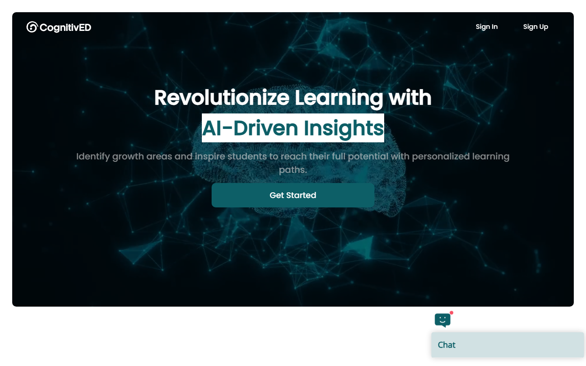
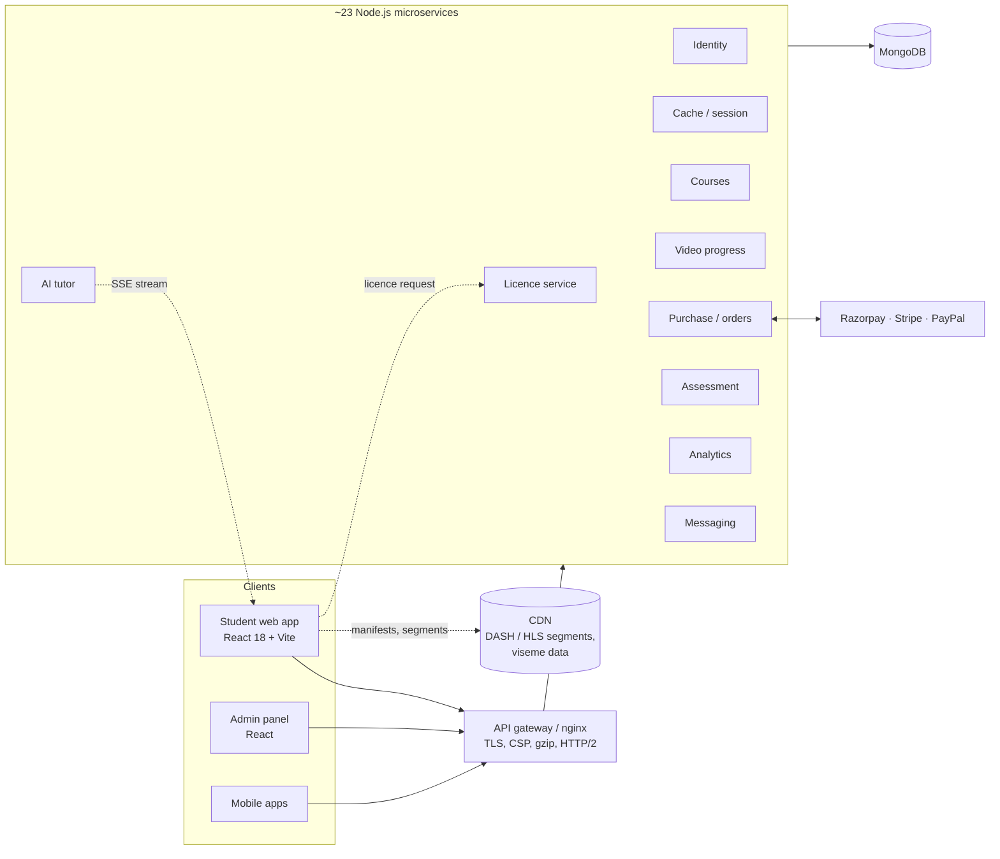

# CognitivED: engineering case study

**An AI-assisted e-learning platform: DRM-protected video lessons, assessments, analytics dashboards, an AI tutor that talks back, and online payments, built on a React SPA, a React admin panel and about 23 Node.js microservices.**

Live product: [cognitive-edu.com](https://amd.cognitive-edu.com/) · My role: Senior Software Engineer at IINVSYS, owner of the student web app and the admin panel, with backend support across the services.

> The source code is proprietary to my employer. This repository documents the architecture, the engineering decisions and the measurable results, which I can discuss in depth in an interview. The **[live demos](https://samir-husain.github.io/cognitived/demos/)** in `demos/` are small browser models of three of the patterns, written by me for this repository.

## What the platform does

| Area | What students get | What I built or own |
|---|---|---|
| Video lessons | Encrypted lessons that play in every major browser, served from a CDN | Shaka Player integration with Widevine (DASH) and FairPlay (HLS), browser-specific playback, watch-progress tracking with an offline queue for completion events |
| AI tutor | Ask a question during a lesson and hear the answer spoken by a lip-synced 3D avatar | Streaming client over Server-Sent Events, sentence-level speech, viseme-driven three.js avatar, instant cancellation, maths rendering with KaTeX |
| Payments | Buy courses and subscriptions with Razorpay, Stripe or PayPal | The whole checkout flow: cross-tab lock, idempotent order creation, durable pending-payment recovery, reconciliation against the order record |
| Assessments and analytics | Timed assessments with proctoring, attempt analysis, progress dashboards, PDF reports | Assessment page, proctoring hooks, dashboards, chart views and report export |
| Parent and admin | Parent portal; admin panel for courses, pricing, promotions and users | Parent module integration; admin panel rebuild (see below) |

## Architecture

The student app composes every service URL from one configuration module (base URL plus a per-service path), so the same build shape runs against dev, staging and production. Failures are classified (`network`, `timeout`, `server`) and published per **scope**, so one failing service degrades its own section of the screen with a Retry, instead of taking the page down. Only retry-safe requests are ever replayed automatically.

## Problems I solved

### 1. Payments that cannot double-charge

Real users click twice, open two tabs, lose the network between "pay" and "paid", and press Back on the gateway's hosted page. The checkout was rebuilt around four pure, unit-tested helpers:

- **Cross-tab checkout lock**: Web Locks plus a localStorage lease with heartbeat and TTL, acquired *before* the order is created and deliberately not released while a payment is pending or unknown.
- **Idempotent order creation**: one stable request key per cart; the gateway amount is checked against the cart before the portal opens (fail closed).
- **Durable pending-payment record**: survives reloads and tab closes; status is reconciled against the backend order record, never inferred from the socket. The payment websocket is an accelerator only.
- **Back/Refresh from the hosted checkout**: a page restored from the back-forward cache reloads instead of showing a frozen "Opening payment portal"; the cancel screen offers "Return to secure payment" for the same session for 25 minutes, so no second order is created.

Result: zero known double charges since the rebuild; every edge case is covered by tests named after the bug report that found it. Try the browser model in the [checkout demo](https://samir-husain.github.io/cognitived/demos/).

### 2. An AI tutor that streams, speaks and stops instantly

Answers come from a self-hosted language model over SSE. The client renders tokens as they arrive, cuts the text into sentences for speech, drives the avatar's mouth from a viseme timeline, and cancels the whole pipeline (stream, speech queue, animation) atomically when the student interrupts. I diagnosed the staging stream time-outs (a proxy closing idle streams) and designed the heartbeat fix. Maths in answers is pre-processed before KaTeX renders it, and the app pins one KaTeX version so two copies cannot fight over class names.

### 3. Protected video in every browser

DASH + Widevine for Chrome, Edge and Firefox; HLS + FairPlay for Safari; MP4 fallback only where DRM is unavailable, with a clear message rather than an unprotected stream. Manifests resolve from the CDN per lesson; watch time and completion are queued offline and flushed when the network returns.

### 4. A commit gate that blocks broken code

On the student app every commit must pass: ESLint with **zero warnings**, type checking across **110 JSDoc-typed files**, about **1,560 unit tests** (Jest + Testing Library on an axios-adapter mock of the whole API) and a production build. **35 Playwright journeys** (sign-in, DRM lessons, quizzes, payments, parent portal) and **axe accessibility checks on 20 screens (0 violations)** run against the deployed staging site. That gate is what made the Create React App → **Vite** migration and the React Router 7 upgrade safe to ship.

### 5. Admin panel rebuild

Restructured into controller / view / utility layers, added **350 Jest and Testing Library tests** and the same zero-warning lint gate, and cut the first JavaScript download from about **870 kB to 125 kB gzipped** through route-level code splitting. On the student app, trimming Bootstrap took the main stylesheet from 940 kB to 735 kB.

### 6. Delivery and operations

Rollback-safe nginx tuning (gzip, caching, HTTP/2, security headers) and a Content-Security-Policy rolled out Report-Only first, then enforced, on staging. Production console silencing, a lazy-route loader that recovers a stale tab after a deploy, and a shared session banner when the backend reports the session as gone.

## Stack

React 18, Vite, React Router 7, Redux, Formik + Yup, Shaka Player (Widevine, FairPlay), three.js, KaTeX, SSE and WebSocket clients, Jest, Testing Library, Playwright, axe, Node.js microservices, MongoDB, nginx, Razorpay, Stripe, PayPal. Version control on the product is SVN with a scripted commit gate.

## How I work

The short version: go deeper until the thing is right, then prove it.

- **Measure, change, re-measure.** Every number in [`docs/quality-scorecard.md`](docs/quality-scorecard.md) comes from a tool, with a before and an after: tests 458 → ~1,560, coverage 46% → 76%, axe 37 → 0, admin bundle 869 → 125 kB.
- **Pure logic, tested alone.** Anything that decides what a screen shows is a pure function with tests next to it. The [`patterns/`](patterns/) folder holds small, dependency-free models of three of them (cross-tab lock, failure classification and replay rule, streaming turn lifecycle), with 14 `node --test` cases run by CI on every push.
- **Verify live, then write it down.** A change is done when it has been exercised in a real browser against staging and the note says what was and was not verified. The dated [`docs/engineering-journal.md`](docs/engineering-journal.md) is that log for Sep to Oct 2026.
- **Rollback-safe operations.** nginx and CSP changes ship with a backup and an automatic restore if the config test fails; CSP went Report-Only first and was enforced only after the full e2e suite ran clean.
- **Decisions are recorded, not just fixes.** "Kept on purpose" items, refused suggestions and known gaps are written down with the reason, so the next person does not re-litigate them.

## In this repository

- `demos/` : three interactive browser models (checkout that cannot double-charge, graceful failure per service, streaming AI answers that cancel). Open them at <https://samir-husain.github.io/cognitived/demos/>.
- `patterns/` : the same three ideas as tested JavaScript modules (`npm test`).
- `docs/architecture.md` : the student web app's structure, the API availability contract and the payment flow in more detail.
- `docs/engineering-journal.md` : dated log of the work, with the numbers at each step.
- `docs/quality-scorecard.md` : before/after table and how each number was measured.

---

Samir Husain · [LinkedIn](https://www.linkedin.com/in/samir-husain1412/) · samirhusain.1412@gmail.com
