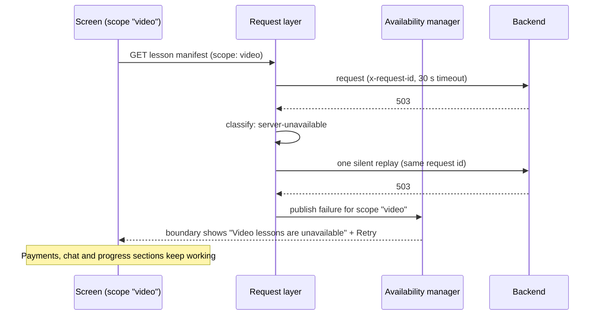
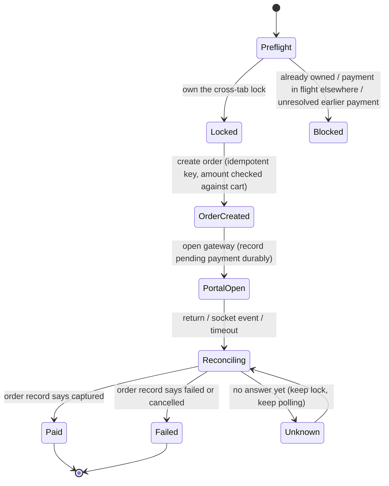

# CognitivED student web app: how it is put together

This is a description of structure and contracts, not source code. Names are illustrative.

## Screen structure (MVC by convention)

Every screen lives in a feature folder with the same split:

- **Controller**: a hook-style function holding all state, effects and API calls; returns a view-model object.
- **Model**: static configuration only (validation schemas, field descriptors, labels). No data fetching.
- **View**: presentational components that call the controller and import their own stylesheet.
- **Utils**: pure functions with unit tests next to them. Anything that decides *what a screen shows* (plan status, promo maths, gateway detection, dashboard sections) lives here so it can be tested without rendering.

The largest screens (video player, assessment, cart, payment plan selection, course dashboard, subscriptions) each have one controller composing focused hooks: for the player that is `useShakaPlayer`, `useWatchProgress`, `useVideoCompletion`, `usePlaybackPreferences`, `useVisemeTimeline`, and so on.

## Routing

Two disjoint route sets switched on the auth token (signed-out and signed-in), every screen code-split behind a lazy loader that reloads once if a stale tab asks for a chunk a deploy removed. Course-scoped routes are additionally gated on *entitlement*; a service outage during that check is treated as "unknown" (hold the route, offer retry), never as "no access".

## API availability contract

- Failures are classified `network` / `timeout` / `server`; only 502, 503, 504 and the identity services' "downstream failed" code count as *unavailable*. A plain 500 propagates to the caller.
- One silent replay, then the user gets Retry / Dismiss; individual waiters expire after 30 seconds.
- **Only retry-safe requests are replayed**: GET/HEAD/OPTIONS, or a write whose caller explicitly vouches for backend idempotency. Nothing that could charge twice is ever replayed automatically.
- Every request carries a stable request id that is preserved across replays so the backend can de-duplicate.
- User-facing copy comes from a capability map ("video lessons", "payments"); internal service names never appear on screen.

## Payment flow

Key rules, each carried in the header comment of the helper that implements it:

1. The lock is acquired **before** order creation and is not released while a payment is pending, captured or unknown.
2. A payment outcome is never shown from a socket message alone; the socket only accelerates a reconciliation against the order record.
3. A pending-payment record is durable (survives reload and tab close) and carries a tombstone when the user abandons a payment, so a stale record cannot block the next checkout forever.
4. Returning from the hosted checkout with Back or Refresh never leaves a frozen screen: a page restored from the back-forward cache reloads, and the cancel screen can reopen the *same* checkout session (only if the link is the gateway's own domain).

## Video and DRM

- Manifest URL = CDN base + lesson asset path + `dash/` or `hls/`.
- Widevine licence from the licence service; FairPlay certificate and licence for Safari; MP4 fallback only where neither is available.
- When the AI module is enabled the player also loads the lesson's viseme timeline to drive the avatar.
- Watch time is accumulated locally and flushed on an interval; completion events are queued offline and retried.

## Quality gate (per commit)

1. `svn add` / missing-file check, no `.only` left in tests
2. ESLint, zero warnings
3. Type check over the `// @ts-check` files (JSDoc types): API layer, payments utils, course access, auth, security, config
4. Jest + Testing Library, single run
5. Production build

Against the deployed staging site: Playwright journeys and axe checks, run from a saved session so no password is ever typed by automation.
